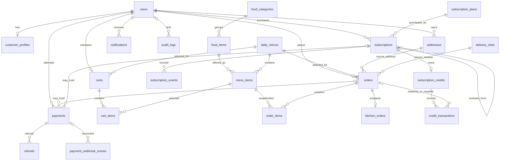

# Phase 3: DailyDabba database design

Phase 3 defined 23 PostgreSQL tables through SQLAlchemy 2.0 models. Phase 4 now
connects PostgreSQL and applies them through Alembic; see [database setup](database-setup.md).
The design itself adds no business API. The existing health endpoint still
returns only `{"status":"ok"}`. Database definitions describe what can be stored;
services and APIs implementing these operations come in later confirmed phases.

Read the complete Python source in the backend README, the generated PostgreSQL
DDL in [schema.sql](schema.sql), and read-only queries in [example_queries.sql](example_queries.sql).
The column reference appended below is generated from the model metadata.

## How to inspect and verify

From `C:/Users/rmshr/OneDrive/Desktop/food_startup/dailydabba/backend`:

```powershell
.\.venv\Scripts\python.exe -m pip install -r requirements.txt
.\.venv\Scripts\python.exe -m pip check
.\.venv\Scripts\python.exe -m pytest -q
.\.venv\Scripts\python.exe -m app.db.export_schema --output docs/schema.sql
```

The exporter prints `Wrote 23 table definitions to docs/schema.sql`. It uses
SQLAlchemy's mock engine as a compiler: it does not connect to PostgreSQL, run SQL,
or require a PostgreSQL driver. The generated SQL is for review, not an Alembic
migration. Do not run it against an existing database. Phase 4 now has a frozen
initial migration tested on an isolated real PostgreSQL database.

Keep using the README's server command and `/docs` for the health endpoint. There
are no new screens or API operations to try in this phase.

## Core concepts and conventions

A table stores one kind of record; a row is one record. A primary key identifies a
row, a foreign key points to another row, a unique constraint rejects duplicates,
and a check constraint rejects invalid values within a row. An index helps locate
rows without scanning an entire table. These mechanisms complement service logic.

Every table has a UUID `id` and timezone-aware `created_at`. UUIDs are generated by
Python on ORM insert; raw SQL inserts must supply IDs. `created_at` uses the database
clock. Named constraints make future Alembic changes easier to review. Foreign-key
columns used for lookup have indexes; primary and unique keys already supply indexes.

All `*_paise` fields are PostgreSQL BIGINT values. INR 85.50 is stored as 8550, never
as a float. Prices, fees, taxes and discounts are explicit, nonnegative integers.
All monetary amounts in this initial design use INR. This does not choose a tax
rate, delivery fee or refund policy; the future service must supply approved rules.

Events use `TIMESTAMP WITH TIME ZONE`. PostgreSQL represents an instant; its display
depends on the session timezone, and Phase 4 configures sessions to UTC and API
code must accept/return aware timestamps. Never store a naive local timestamp in
an event column. Chennai's business timezone is `Asia/Kolkata`.

`business_date`, subscription dates and skip dates are calendar dates in Chennai.
Delivery-slot clock times are local `TIME WITHOUT TIME ZONE`, not UTC instants.
At checkout, combine menu date + slot local times with `ZoneInfo('Asia/Kolkata')`,
convert to UTC, and snapshot `delivery_start_at`/`delivery_end_at` on the order.
A check keeps both instants on the selected Chennai business date. Slot changes
later cannot alter those order snapshots. This design currently supports same-day,
non-overnight delivery windows; discuss any overnight requirement before migrations.
Subscription `starts_on` is inclusive and `expires_on` is exclusive in Chennai.

## Table responsibilities and design choices

### Identity

- **users:** canonical lowercase unique email, password hash, one role, account
  activity and deactivation timestamp. No plaintext passwords or tokens. Roles are
  constrained values: customer, admin, kitchen_staff. A separate roles table and
  join table add little value while one user has one role. Revisit if multiple
  simultaneous roles are required. Authentication and Argon2 hashing are Phase 5.
- **customer_profiles:** optional one-to-one private customer name and phone. A
  unique user foreign key prevents duplicate profiles.
- **addresses:** recipient and postal address, owner, default flag and deletion
  timestamp. Deletion means soft deletion. A partial unique index permits at most
  one live default per user; it does not require a user to always have a default.
  The API must validate PIN-code digits, service area and ownership in Phase 6.

### Food and scheduling

- **food_categories:** category name and active flag.
- **food_items:** reusable food description, catalog price, category and activity/
  availability flags. Retire items instead of deleting historical references.
- **daily_menus:** one menu per Chennai date and breakfast/lunch/dinner meal type.
  Menus start inactive until explicitly published.
- **menu_items:** each food item offered once in a menu, with the actual offering
  price and nonnegative portions remaining. Stock starts at zero and availability
  starts false. Catalog price is only a default when preparing the menu; checkout
  uses the selected menu item's current price. Active category/item/menu and
  offering availability must all be checked by the later service.
- **delivery_slots:** local clock windows for a meal type, with active flag.
  No delivery times have been seeded or chosen for the business.

### Cart and historical orders

- **carts:** at most one current cart per user, selecting one dated meal menu.
- **cart_items:** quantity and menu offering; no client-supplied authoritative
  price. Composite foreign keys stop an offering from another menu entering a cart.
  These disposable records are the only records with cascading deletes.
- **orders:** owner, selected menu/date/meal, delivery slot, address and time
  snapshots, price components, status, idempotency key and request hash. Composite
  keys enforce address ownership and matching menu date/meal and slot meal type.
  A pending order has no implied verified payment or reserved stock.
- **order_items:** immutable-in-service food-name and unit-price snapshots plus
  quantity. The database computes line total as unit price times quantity. The
  order's subtotal must equal the sum of these rows; that cross-row rule belongs
  in the future checkout transaction, not a single-row CHECK.

One cart/order covers one dated meal menu. This is a proposed initial checkout
boundary, not a frontend decision. Multi-date or multi-meal checkout would create
separate orders; confirm that assumption before implementing Phase 8/9.

Order totals obey `subtotal + delivery_fee + tax - discount = total`, and all
amounts are nonnegative. Changing a menu price, food name or address later must
not rewrite historical snapshots. Address JSON must be a JSON object; required
snapshot fields will also need Pydantic validation in the future order service.

The order status check limits vocabulary; it does not enforce allowed transitions.
Cancellation deadlines, stock reservation timing and transition rules remain Phase 9.

### Subscriptions and credits

- **subscription_plans:** weekly/monthly label, explicit duration days, meal type,
  included credits, price and publication flag. No assumption that monthly means
  exactly 30 days; publish a reviewed plan with explicit terms.
- **subscriptions:** purchased plan-name, meal type, price and credits snapshots,
  Chennai validity dates, status, policy JSON and optional prior subscription for
  renewal history. Composite renewal keys require the same owner. There is no
  automatic recurring payment collection.
- **subscription_events:** append-only-in-service activation, pause, resume, skip,
  renewal, expiration and cancellation history. Records contain effective local
  date, actor, reason and unique event key. A partial index prevents duplicate skips
  for the same subscription and date. Supporting undo-skip would need an explicit
  compensating event/policy; it is not silently implemented here.
- **subscription_credits:** one account per subscription, belonging to the same
  user, with cached balance constrained to be nonnegative.
- **credit_transactions:** signed changes linked to the account and optionally an
  owned order. Grant/restore are positive; debit/expire are negative; audited
  adjustments may have either sign. Debits and restores must reference an order.
  Unique account/event key protects retries; unique account/order/kind prevents a
  second debit or restore of that order from the same account. Only one purchase
  grant per account is allowed, including retries with changed request keys.

The ledger is the source of financial history. Its sum must match the cached
balance. Each entry is a new event; correction means a compensating entry with a
reason, not editing an earlier event. Renewal creates a new subscription/account.
Purchase grants must follow verified payment; neither models nor status defaults
perform that verification.

### Payment evidence and operations

- **payments:** one payment-attempt record targeting exactly one owned order OR
  subscription, with exact amount, provider IDs, status and unique request key.
  Non-null provider payment IDs cannot be repeated. Provider order ID is indexed
  but not unique because multiple payment attempts can share it. Multiple real
  captures must be recorded for reconciliation; fulfillment must still occur once.
- **refunds:** a payment-linked amount, reason, status, provider refund ID and
  idempotency key. Provider refund IDs and per-payment request keys are unique.
- **payment_webhook_events:** unique provider/event ID, SHA-256 raw-payload hash,
  sanitized evidence JSON, processing state and optional matched payment. This
  supports later retries/reconciliation. It is not a webhook endpoint or verifier.
- **kitchen_orders:** at most one kitchen work record per order, with preparation
  status and timestamps. Daily quantities can be aggregated from order snapshots;
  no separate derived-count table is needed.
- **notifications:** user-targeted channel, sanitized payload, status and globally
  unique event key. Use a key scoped to the recipient and channel in the service.
  No email/SMS/push provider has been connected.
- **audit_logs:** actor (nullable for system events), action, target type/UUID and
  sanitized details. Target IDs intentionally have no polymorphic foreign key;
  this keeps evidence independent of whether an operational object still exists.
  Never log password hashes, tokens, provider secrets or full payment payloads.

## Database safeguards versus service safeguards

The model definitions provide primary/foreign keys, nonnegative checks, status
vocabularies, unique event/request keys, partial unique default/skip/grant indexes,
owner-compatible composite references, and stored order-item arithmetic.

They DO NOT by themselves guarantee exactly-once external payment collection,
valid state transitions, correct cross-row totals, append-only history, deadline
rules or safe concurrent balances. PostgreSQL CHECK constraints cannot validate
other rows or tables. These need transactions and, where appropriate, restricted
runtime database privileges or triggers in later reviewed migrations.

### Planned concurrent credit redemption (Phase 10)

1. Begin a database transaction; load the account with `SELECT ... FOR UPDATE`.
2. Check a prior event/order operation. Same key and same canonical request hash
   returns the previous result; a reused key with changed input is a conflict.
3. Check ownership, active subscription, policy and available balance. Determine
   the fulfillment point for deduction according to the team's approved policy.
4. Atomically reduce balance only if sufficient, then insert the uniquely keyed
   negative ledger entry and the fulfillment change in the SAME transaction.
5. Commit once. On uniqueness conflict, roll back, then read the prior operation.

All writers must follow the same lock/update protocol. The nonnegative CHECK is
an additional guard, not a substitute for this protocol. The design supports
per-account deductions; whether one order can combine multiple accounts and any
partial restorations needs explicit Phase 10 policy before services are written.

Skip deadlines, pause extensions, expiry treatment, deduction timing, credit-to-
meal conversion and refund eligibility remain unapproved. No sample values are
silently treated as final business rules. `policy_snapshot` must be populated from
approved, versioned configuration at purchase; it is not a license to trust client JSON.

### Planned payment/refund processing (Phase 11)

Verify signatures on the exact raw webhook bytes before recording/processing the
event. Use a dedicated secret from environment configuration; no secrets belong in
these tables. Validate captured amount, currency and business target server-side.
Deduplicate both the provider event ID and the provider payment ID. Events may arrive
out of order or use different event IDs for the same capture: never activate a
subscription or grant credits merely because a new webhook row was inserted.

Lock the payment/target and atomically record fulfillment and its unique business
operation. Only verified captures may activate subscriptions. Lock the payment
when issuing refunds and include pending/processing/succeeded refunds in the
reserved cumulative amount, so concurrent requests cannot over-refund. Do not
make provider API calls while holding a long database lock; design the request
and reconciliation sequence in Phase 11. No real credentials or provider calls
are used in this phase.

### Deletion and privacy

All historical foreign keys use RESTRICT. ORM relationships do not use delete
cascade for financial/order history. This blocks some deletes, but a leaf ledger,
refund or audit row can still be deleted by a privileged database user. Phase 4 now separates schema ownership from the runtime role and tests
column/table grants that prohibit runtime updates/deletes on append-only evidence
and snapshot fields. A schema owner can still change these records, and future
services must prevent appending new items to finalized orders and enforce full
business invariants. See database-setup.md for the exact boundaries.

Deactivate users, soft-delete addresses and retire catalog/plans. Never use hard
deletes as the customer-facing cancellation/refund operation. Retain only needed
PII and define a reviewed retention/anonymization policy before production; old
address snapshots cannot simply be erased by editing the address book.

## Relationship diagram

This diagram shows every designed table. Column details and constraints follow
below and are specified fully in `schema.sql` and the Python models.



The diagram is structural. A usable order must have items, but the foreign key
alone permits a temporarily empty order during a transaction. The service must
check it before commit. Payment's exactly-one-target check is not expressible as
both lines in Mermaid, so read it together with the constraint explanation.

## Sources and limits

- [SQLAlchemy annotated mappings](https://docs.sqlalchemy.org/en/20/orm/declarative_tables.html)
  documents `Mapped` and `mapped_column` used by these models.
- [SQLAlchemy constraints](https://docs.sqlalchemy.org/en/20/core/constraints.html)
  explains the composite references and named constraints used here.
- [PostgreSQL constraints](https://www.postgresql.org/docs/current/ddl-constraints.html)
  explains why cross-row rules need more than a CHECK.

The PostgreSQL DDL has been compiled and model wiring checked. A real PostgreSQL
server now validates the constraints in the Phase 4 integration suite. Business
concurrency protocols remain future service work; see database-setup.md for verified
coverage and the difference between ordinary tests and --run-db.

## Full column and constraint reference

Generated from the SQLAlchemy mappings. UUID defaults and boolean/status defaults
are applied by ORM inserts unless shown as server defaults in schema.sql. Each
required field must be supplied if no applicable default exists. SQL NOT NULL
is separate from string/content validation in future request schemas.

### daily_menus

- `business_date` — `DATE`; required.
- `meal_type` — `VARCHAR(12)`; required.
- `is_active` — `BOOLEAN`; required.
- `id` — `UUID`; primary key; required.
- `created_at` — `TIMESTAMP WITH TIME ZONE`; required; server default: now().

Constraints and lookup indexes:

- CHECK `meal_type IN ('breakfast', 'lunch', 'dinner')`.
- UNIQUE `(business_date, meal_type)`.
- UNIQUE `(id, business_date, meal_type)`.

### delivery_slots

- `name` — `VARCHAR(80)`; required.
- `meal_type` — `VARCHAR(12)`; required.
- `start_local` — `TIME WITHOUT TIME ZONE`; required.
- `end_local` — `TIME WITHOUT TIME ZONE`; required.
- `is_active` — `BOOLEAN`; required.
- `id` — `UUID`; primary key; required.
- `created_at` — `TIMESTAMP WITH TIME ZONE`; required; server default: now().

Constraints and lookup indexes:

- CHECK `meal_type IN ('breakfast', 'lunch', 'dinner')`.
- CHECK `end_local > start_local`.
- UNIQUE `(id, meal_type)`.
- UNIQUE `(meal_type, start_local, end_local)`.

### food_categories

- `name` — `VARCHAR(80)`; required.
- `is_active` — `BOOLEAN`; required.
- `id` — `UUID`; primary key; required.
- `created_at` — `TIMESTAMP WITH TIME ZONE`; required; server default: now().

Constraints and lookup indexes:

- UNIQUE `(name)`.

### subscription_plans

- `code` — `VARCHAR(50)`; required.
- `name` — `VARCHAR(120)`; required.
- `period` — `VARCHAR(12)`; required.
- `meal_type` — `VARCHAR(12)`; required.
- `duration_days` — `INTEGER`; required.
- `included_credits` — `INTEGER`; required.
- `price_paise` — `BIGINT`; required.
- `is_active` — `BOOLEAN`; required.
- `id` — `UUID`; primary key; required.
- `created_at` — `TIMESTAMP WITH TIME ZONE`; required; server default: now().

Constraints and lookup indexes:

- CHECK `meal_type IN ('breakfast', 'lunch', 'dinner')`.
- CHECK `period IN ('weekly', 'monthly')`.
- CHECK `duration_days > 0 AND included_credits > 0 AND price_paise >= 0`.
- UNIQUE `(code)`.

### users

- `email` — `VARCHAR(254)`; required.
- `password_hash` — `VARCHAR(512)`; required.
- `role` — `VARCHAR(20)`; required.
- `is_active` — `BOOLEAN`; required.
- `deactivated_at` — `TIMESTAMP WITH TIME ZONE`; nullable.
- `id` — `UUID`; primary key; required.
- `created_at` — `TIMESTAMP WITH TIME ZONE`; required; server default: now().

Constraints and lookup indexes:

- CHECK `email = lower(email) AND length(email) > 3`.
- CHECK `role IN ('customer', 'admin', 'kitchen_staff')`.
- UNIQUE `(email)`.

### addresses

- `user_id` — `UUID`; required.
- `label` — `VARCHAR(50)`; required.
- `recipient_name` — `VARCHAR(120)`; required.
- `phone` — `VARCHAR(20)`; required.
- `line1` — `VARCHAR(200)`; required.
- `line2` — `VARCHAR(200)`; nullable.
- `locality` — `VARCHAR(120)`; required.
- `city` — `VARCHAR(80)`; required.
- `state` — `VARCHAR(80)`; required.
- `postal_code` — `VARCHAR(6)`; required.
- `is_default` — `BOOLEAN`; required.
- `deleted_at` — `TIMESTAMP WITH TIME ZONE`; nullable.
- `id` — `UUID`; primary key; required.
- `created_at` — `TIMESTAMP WITH TIME ZONE`; required; server default: now().

Constraints and lookup indexes:

- CHECK `NOT is_default OR deleted_at IS NULL`.
- CHECK `length(postal_code) = 6`.
- Foreign key `(user_id)` to `(users.id)`; delete RESTRICT.
- UNIQUE `(id, user_id)`.
- index `(user_id)`.
- UNIQUE index `(user_id)`; WHERE `is_default AND deleted_at IS NULL`.

### audit_logs

- `actor_user_id` — `UUID`; nullable.
- `action` — `VARCHAR(100)`; required.
- `target_type` — `VARCHAR(80)`; required.
- `target_id` — `UUID`; required.
- `details` — `JSONB`; required.
- `id` — `UUID`; primary key; required.
- `created_at` — `TIMESTAMP WITH TIME ZONE`; required; server default: now().

Constraints and lookup indexes:

- CHECK `jsonb_typeof(details) = 'object'`.
- Foreign key `(actor_user_id)` to `(users.id)`; delete RESTRICT.
- index `(actor_user_id)`.
- index `(target_id)`.

### carts

- `user_id` — `UUID`; required.
- `menu_id` — `UUID`; required.
- `id` — `UUID`; primary key; required.
- `created_at` — `TIMESTAMP WITH TIME ZONE`; required; server default: now().

Constraints and lookup indexes:

- Foreign key `(menu_id)` to `(daily_menus.id)`; delete RESTRICT.
- Foreign key `(user_id)` to `(users.id)`; delete RESTRICT.
- UNIQUE `(id, menu_id)`.
- UNIQUE `(user_id)`.
- index `(menu_id)`.

### customer_profiles

- `user_id` — `UUID`; required.
- `full_name` — `VARCHAR(120)`; required.
- `phone` — `VARCHAR(20)`; nullable.
- `id` — `UUID`; primary key; required.
- `created_at` — `TIMESTAMP WITH TIME ZONE`; required; server default: now().

Constraints and lookup indexes:

- Foreign key `(user_id)` to `(users.id)`; delete RESTRICT.
- UNIQUE `(user_id)`.

### food_items

- `category_id` — `UUID`; required.
- `name` — `VARCHAR(120)`; required.
- `description` — `TEXT`; required.
- `price_paise` — `BIGINT`; required.
- `is_active` — `BOOLEAN`; required.
- `is_available` — `BOOLEAN`; required.
- `id` — `UUID`; primary key; required.
- `created_at` — `TIMESTAMP WITH TIME ZONE`; required; server default: now().

Constraints and lookup indexes:

- CHECK `price_paise >= 0`.
- Foreign key `(category_id)` to `(food_categories.id)`; delete RESTRICT.
- index `(category_id)`.

### notifications

- `user_id` — `UUID`; required.
- `event_key` — `VARCHAR(150)`; required.
- `channel` — `VARCHAR(12)`; required.
- `status` — `VARCHAR(12)`; required.
- `payload` — `JSONB`; required.
- `sent_at` — `TIMESTAMP WITH TIME ZONE`; nullable.
- `id` — `UUID`; primary key; required.
- `created_at` — `TIMESTAMP WITH TIME ZONE`; required; server default: now().

Constraints and lookup indexes:

- CHECK `channel IN ('in_app', 'email', 'sms')`.
- CHECK `jsonb_typeof(payload) = 'object'`.
- CHECK `status IN ('pending', 'sent', 'failed', 'read')`.
- Foreign key `(user_id)` to `(users.id)`; delete RESTRICT.
- UNIQUE `(event_key)`.
- index `(status)`.
- index `(user_id)`.

### subscriptions

- `user_id` — `UUID`; required.
- `plan_id` — `UUID`; required.
- `renewed_from_id` — `UUID`; nullable.
- `plan_name` — `VARCHAR(120)`; required.
- `meal_type` — `VARCHAR(12)`; required.
- `purchased_credits` — `INTEGER`; required.
- `price_paise` — `BIGINT`; required.
- `starts_on` — `DATE`; required.
- `expires_on` — `DATE`; required.
- `status` — `VARCHAR(20)`; required.
- `policy_snapshot` — `JSONB`; required.
- `idempotency_key` — `VARCHAR(128)`; required.
- `request_hash` — `VARCHAR(64)`; required.
- `id` — `UUID`; primary key; required.
- `created_at` — `TIMESTAMP WITH TIME ZONE`; required; server default: now().

Constraints and lookup indexes:

- CHECK `expires_on > starts_on`.
- CHECK `meal_type IN ('breakfast', 'lunch', 'dinner')`.
- CHECK `jsonb_typeof(policy_snapshot) = 'object'`.
- CHECK `purchased_credits > 0 AND price_paise >= 0`.
- CHECK `length(idempotency_key) > 0 AND length(request_hash) = 64`.
- CHECK `status IN ('pending_payment', 'active', 'paused', 'expired', 'cancelled')`.
- Foreign key `(plan_id)` to `(subscription_plans.id)`; delete RESTRICT.
- Foreign key `(renewed_from_id, user_id)` to `(subscriptions.id, subscriptions.user_id)`; delete RESTRICT.
- Foreign key `(user_id)` to `(users.id)`; delete RESTRICT.
- UNIQUE `(id, user_id)`.
- UNIQUE `(user_id, idempotency_key)`.
- index `(plan_id)`.
- index `(renewed_from_id)`.
- index `(status)`.
- index `(user_id)`.

### menu_items

- `menu_id` — `UUID`; required.
- `food_item_id` — `UUID`; required.
- `price_paise` — `BIGINT`; required.
- `portions_remaining` — `INTEGER`; required.
- `is_available` — `BOOLEAN`; required.
- `id` — `UUID`; primary key; required.
- `created_at` — `TIMESTAMP WITH TIME ZONE`; required; server default: now().

Constraints and lookup indexes:

- CHECK `price_paise >= 0`.
- CHECK `portions_remaining >= 0`.
- Foreign key `(food_item_id)` to `(food_items.id)`; delete RESTRICT.
- Foreign key `(menu_id)` to `(daily_menus.id)`; delete RESTRICT.
- UNIQUE `(id, menu_id)`.
- UNIQUE `(menu_id, food_item_id)`.
- index `(food_item_id)`.
- index `(menu_id)`.

### orders

- `user_id` — `UUID`; required.
- `address_id` — `UUID`; required.
- `address_snapshot` — `JSONB`; required.
- `menu_id` — `UUID`; required.
- `business_date` — `DATE`; required.
- `meal_type` — `VARCHAR(12)`; required.
- `delivery_slot_id` — `UUID`; required.
- `delivery_start_at` — `TIMESTAMP WITH TIME ZONE`; required.
- `delivery_end_at` — `TIMESTAMP WITH TIME ZONE`; required.
- `subtotal_paise` — `BIGINT`; required.
- `delivery_fee_paise` — `BIGINT`; required.
- `tax_paise` — `BIGINT`; required.
- `discount_paise` — `BIGINT`; required.
- `total_paise` — `BIGINT`; required.
- `status` — `VARCHAR(24)`; required.
- `idempotency_key` — `VARCHAR(128)`; required.
- `request_hash` — `VARCHAR(64)`; required.
- `id` — `UUID`; primary key; required.
- `created_at` — `TIMESTAMP WITH TIME ZONE`; required; server default: now().

Constraints and lookup indexes:

- CHECK `jsonb_typeof(address_snapshot) = 'object'`.
- CHECK `subtotal_paise >= 0 AND delivery_fee_paise >= 0 AND tax_paise >= 0 AND discount_paise >= 0 AND total_paise >= 0`.
- CHECK `business_date = (delivery_start_at AT TIME ZONE 'Asia/Kolkata')::date AND business_date = (delivery_end_at AT TIME ZONE 'Asia/Kolkata')::date`.
- CHECK `delivery_end_at > delivery_start_at`.
- CHECK `length(idempotency_key) > 0 AND length(request_hash) = 64`.
- CHECK `status IN ('pending_payment', 'placed', 'confirmed', 'preparing', 'ready', 'out_for_delivery', 'delivered', 'cancelled')`.
- CHECK `total_paise = subtotal_paise + delivery_fee_paise + tax_paise - discount_paise`.
- Foreign key `(address_id, user_id)` to `(addresses.id, addresses.user_id)`; delete RESTRICT.
- Foreign key `(delivery_slot_id, meal_type)` to `(delivery_slots.id, delivery_slots.meal_type)`; delete RESTRICT.
- Foreign key `(menu_id, business_date, meal_type)` to `(daily_menus.id, daily_menus.business_date, daily_menus.meal_type)`; delete RESTRICT.
- Foreign key `(user_id)` to `(users.id)`; delete RESTRICT.
- UNIQUE `(id, menu_id)`.
- UNIQUE `(id, user_id)`.
- UNIQUE `(user_id, idempotency_key)`.
- index `(address_id)`.
- index `(business_date)`.
- index `(delivery_slot_id)`.
- index `(menu_id)`.
- index `(status)`.
- index `(user_id)`.

### subscription_credits

- `subscription_id` — `UUID`; required.
- `user_id` — `UUID`; required.
- `balance` — `INTEGER`; required.
- `id` — `UUID`; primary key; required.
- `created_at` — `TIMESTAMP WITH TIME ZONE`; required; server default: now().

Constraints and lookup indexes:

- CHECK `balance >= 0`.
- Foreign key `(subscription_id, user_id)` to `(subscriptions.id, subscriptions.user_id)`; delete RESTRICT.
- UNIQUE `(id, user_id)`.
- UNIQUE `(subscription_id)`.
- index `(user_id)`.

### subscription_events

- `subscription_id` — `UUID`; required.
- `event_type` — `VARCHAR(16)`; required.
- `effective_date` — `DATE`; required.
- `event_key` — `VARCHAR(128)`; required.
- `reason` — `VARCHAR(300)`; required.
- `actor_user_id` — `UUID`; nullable.
- `id` — `UUID`; primary key; required.
- `created_at` — `TIMESTAMP WITH TIME ZONE`; required; server default: now().

Constraints and lookup indexes:

- CHECK `length(event_key) > 0`.
- CHECK `event_type IN ('activate', 'pause', 'resume', 'skip', 'renew', 'expire', 'cancel')`.
- Foreign key `(actor_user_id)` to `(users.id)`; delete RESTRICT.
- Foreign key `(subscription_id)` to `(subscriptions.id)`; delete RESTRICT.
- UNIQUE `(subscription_id, event_key)`.
- index `(actor_user_id)`.
- index `(subscription_id)`.
- UNIQUE index `(subscription_id, effective_date)`; WHERE `event_type = 'skip'`.

### cart_items

- `cart_id` — `UUID`; required.
- `menu_id` — `UUID`; required.
- `menu_item_id` — `UUID`; required.
- `quantity` — `INTEGER`; required.
- `id` — `UUID`; primary key; required.
- `created_at` — `TIMESTAMP WITH TIME ZONE`; required; server default: now().

Constraints and lookup indexes:

- CHECK `quantity > 0`.
- Foreign key `(cart_id, menu_id)` to `(carts.id, carts.menu_id)`; delete CASCADE.
- Foreign key `(menu_item_id, menu_id)` to `(menu_items.id, menu_items.menu_id)`; delete RESTRICT.
- UNIQUE `(cart_id, menu_item_id)`.
- index `(cart_id)`.
- index `(menu_id)`.
- index `(menu_item_id)`.

### credit_transactions

- `account_id` — `UUID`; required.
- `user_id` — `UUID`; required.
- `order_id` — `UUID`; nullable.
- `kind` — `VARCHAR(12)`; required.
- `delta` — `INTEGER`; required.
- `event_key` — `VARCHAR(128)`; required.
- `request_hash` — `VARCHAR(64)`; required.
- `reason` — `VARCHAR(300)`; required.
- `actor_user_id` — `UUID`; nullable.
- `id` — `UUID`; primary key; required.
- `created_at` — `TIMESTAMP WITH TIME ZONE`; required; server default: now().

Constraints and lookup indexes:

- CHECK `(kind IN ('grant', 'restore') AND delta > 0) OR (kind IN ('debit', 'expire') AND delta < 0) OR kind = 'adjust'`.
- CHECK `delta <> 0`.
- CHECK `length(event_key) > 0 AND length(request_hash) = 64 AND length(reason) > 0`.
- CHECK `kind IN ('grant', 'debit', 'restore', 'expire', 'adjust')`.
- CHECK `kind NOT IN ('debit', 'restore') OR order_id IS NOT NULL`.
- Foreign key `(account_id, user_id)` to `(subscription_credits.id, subscription_credits.user_id)`; delete RESTRICT.
- Foreign key `(actor_user_id)` to `(users.id)`; delete RESTRICT.
- Foreign key `(order_id, user_id)` to `(orders.id, orders.user_id)`; delete RESTRICT.
- UNIQUE `(account_id, event_key)`.
- UNIQUE `(account_id, order_id, kind)`.
- index `(account_id)`.
- index `(actor_user_id)`.
- index `(order_id)`.
- index `(user_id)`.
- UNIQUE index `(account_id)`; WHERE `kind = 'grant'`.

### kitchen_orders

- `order_id` — `UUID`; required.
- `status` — `VARCHAR(16)`; required.
- `started_at` — `TIMESTAMP WITH TIME ZONE`; nullable.
- `ready_at` — `TIMESTAMP WITH TIME ZONE`; nullable.
- `id` — `UUID`; primary key; required.
- `created_at` — `TIMESTAMP WITH TIME ZONE`; required; server default: now().

Constraints and lookup indexes:

- CHECK `status IN ('queued', 'preparing', 'ready', 'completed', 'cancelled')`.
- Foreign key `(order_id)` to `(orders.id)`; delete RESTRICT.
- UNIQUE `(order_id)`.
- index `(status)`.

### order_items

- `order_id` — `UUID`; required.
- `menu_id` — `UUID`; required.
- `menu_item_id` — `UUID`; required.
- `food_name` — `VARCHAR(120)`; required.
- `unit_price_paise` — `BIGINT`; required.
- `quantity` — `INTEGER`; required.
- `line_total_paise` — `BIGINT`; required; computed: unit_price_paise * quantity.
- `id` — `UUID`; primary key; required.
- `created_at` — `TIMESTAMP WITH TIME ZONE`; required; server default: now().

Constraints and lookup indexes:

- CHECK `quantity > 0 AND unit_price_paise >= 0`.
- Foreign key `(menu_item_id, menu_id)` to `(menu_items.id, menu_items.menu_id)`; delete RESTRICT.
- Foreign key `(order_id, menu_id)` to `(orders.id, orders.menu_id)`; delete RESTRICT.
- UNIQUE `(order_id, menu_item_id)`.
- index `(menu_id)`.
- index `(menu_item_id)`.
- index `(order_id)`.

### payments

- `user_id` — `UUID`; required.
- `order_id` — `UUID`; nullable.
- `subscription_id` — `UUID`; nullable.
- `amount_paise` — `BIGINT`; required.
- `currency` — `VARCHAR(3)`; required.
- `provider` — `VARCHAR(20)`; required.
- `provider_order_id` — `VARCHAR(100)`; nullable.
- `provider_payment_id` — `VARCHAR(100)`; nullable.
- `status` — `VARCHAR(16)`; required.
- `captured_at` — `TIMESTAMP WITH TIME ZONE`; nullable.
- `idempotency_key` — `VARCHAR(128)`; required.
- `request_hash` — `VARCHAR(64)`; required.
- `id` — `UUID`; primary key; required.
- `created_at` — `TIMESTAMP WITH TIME ZONE`; required; server default: now().

Constraints and lookup indexes:

- CHECK `amount_paise > 0 AND currency = 'INR'`.
- CHECK `(status = 'captured') = (captured_at IS NOT NULL)`.
- CHECK `(order_id IS NOT NULL AND subscription_id IS NULL) OR (order_id IS NULL AND subscription_id IS NOT NULL)`.
- CHECK `provider = 'razorpay'`.
- CHECK `length(idempotency_key) > 0 AND length(request_hash) = 64`.
- CHECK `status IN ('created', 'authorized', 'captured', 'failed')`.
- Foreign key `(order_id, user_id)` to `(orders.id, orders.user_id)`; delete RESTRICT.
- Foreign key `(subscription_id, user_id)` to `(subscriptions.id, subscriptions.user_id)`; delete RESTRICT.
- Foreign key `(user_id)` to `(users.id)`; delete RESTRICT.
- UNIQUE `(provider, provider_payment_id)`.
- UNIQUE `(user_id, idempotency_key)`.
- index `(order_id)`.
- index `(provider_order_id)`.
- index `(status)`.
- index `(subscription_id)`.
- index `(user_id)`.

### payment_webhook_events

- `provider` — `VARCHAR(20)`; required.
- `provider_event_id` — `VARCHAR(150)`; required.
- `payment_id` — `UUID`; nullable.
- `event_type` — `VARCHAR(100)`; required.
- `payload_hash` — `VARCHAR(64)`; required.
- `sanitized_payload` — `JSONB`; required.
- `status` — `VARCHAR(16)`; required.
- `processed_at` — `TIMESTAMP WITH TIME ZONE`; nullable.
- `id` — `UUID`; primary key; required.
- `created_at` — `TIMESTAMP WITH TIME ZONE`; required; server default: now().

Constraints and lookup indexes:

- CHECK `length(provider_event_id) > 0 AND length(payload_hash) = 64`.
- CHECK `jsonb_typeof(sanitized_payload) = 'object'`.
- CHECK `provider = 'razorpay'`.
- CHECK `status IN ('received', 'processed', 'failed')`.
- Foreign key `(payment_id)` to `(payments.id)`; delete RESTRICT.
- UNIQUE `(provider, provider_event_id)`.
- index `(payment_id)`.
- index `(status)`.

### refunds

- `payment_id` — `UUID`; required.
- `amount_paise` — `BIGINT`; required.
- `status` — `VARCHAR(16)`; required.
- `reason` — `VARCHAR(300)`; required.
- `provider_refund_id` — `VARCHAR(100)`; nullable.
- `idempotency_key` — `VARCHAR(128)`; required.
- `request_hash` — `VARCHAR(64)`; required.
- `id` — `UUID`; primary key; required.
- `created_at` — `TIMESTAMP WITH TIME ZONE`; required; server default: now().

Constraints and lookup indexes:

- CHECK `amount_paise > 0`.
- CHECK `length(idempotency_key) > 0 AND length(request_hash) = 64`.
- CHECK `status IN ('requested', 'processing', 'succeeded', 'failed')`.
- Foreign key `(payment_id)` to `(payments.id)`; delete RESTRICT.
- UNIQUE `(payment_id, idempotency_key)`.
- UNIQUE `(provider_refund_id)`.
- index `(payment_id)`.
